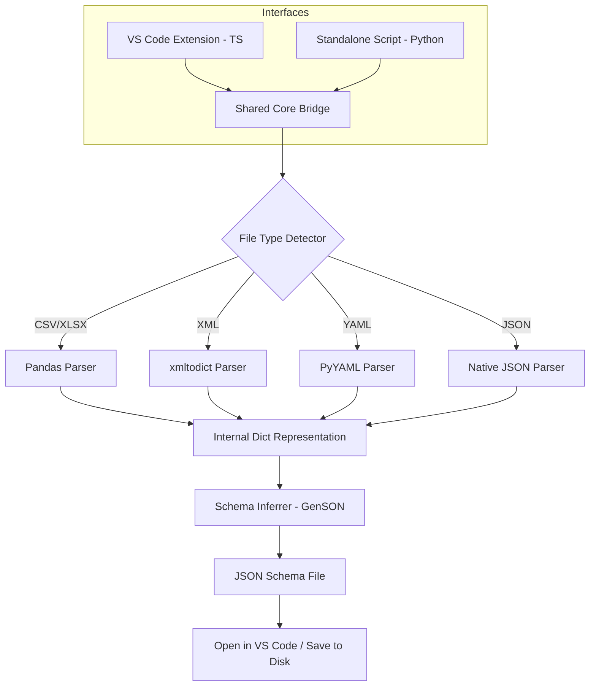

# Architecture Diagram & Flow

## 1. High-Level Flow (Mermaid)

## 2. Component Breakdown
- **VS Code Extension (`/extension`):** TypeScript-based frontend that registers context menus and spawns the Python Core.
- **Standalone Script (`/scripts/run.py`):** Direct entry point to the Python Core for non-VS Code users.
- **Shared Core Engine (`/core`):** The Python logic that handles parsing, normalization, and schema inference.
- **Parser Registry:** Modular handlers for different file formats.
